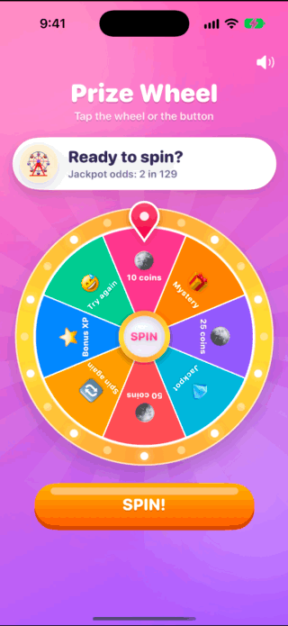
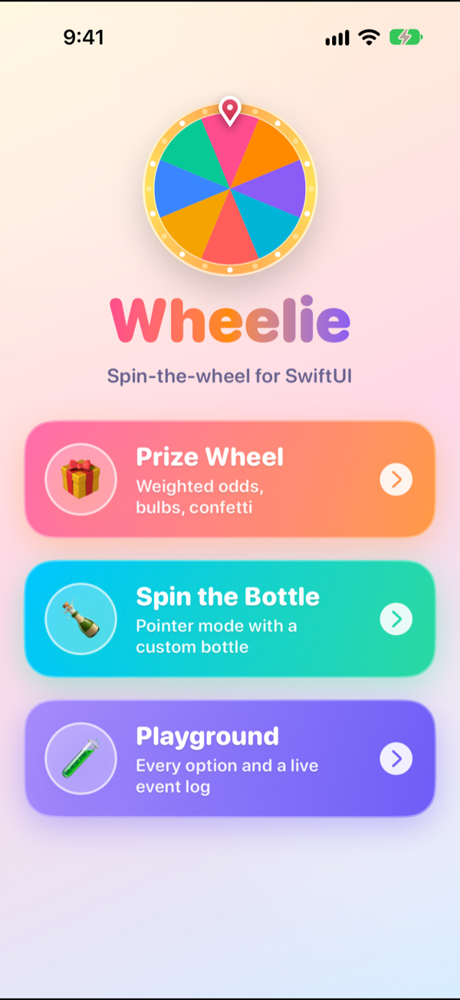
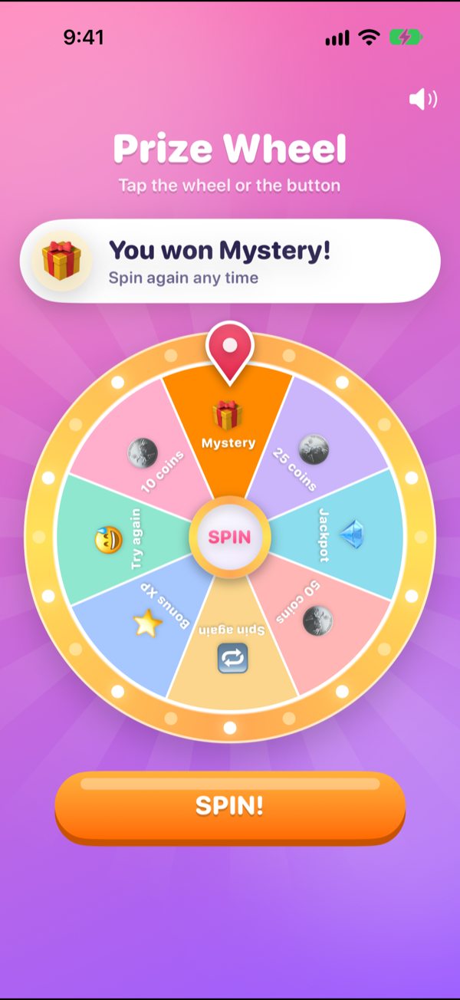
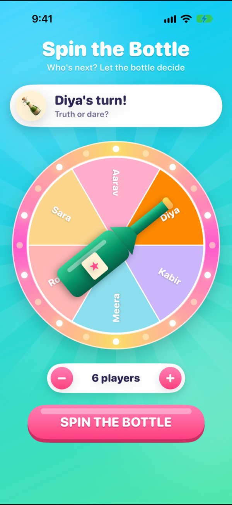
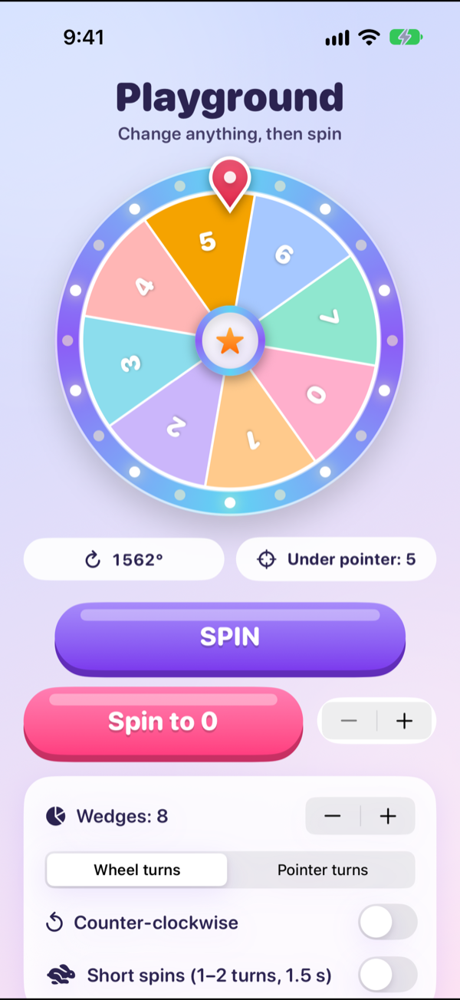

# Wheelie

[](https://github.com/VasuChovatiya/Wheelie/actions/workflows/ci.yml)


[](.swiftlint.yml)

A spin-the-wheel component for SwiftUI and UIKit. It picks the winner first, then animates to it, so the wedge on screen and the result in your code always agree. A shared spec and test vectors fix the math, so a React Native port (planned) can land on exactly the same wedges.

<p align="center">
  
</p>

| Menu | Prize wheel | Spin the bottle | Playground |
|---|---|---|---|
|  |  |  |  |

## Why

A prize wheel and a spin-the-bottle game are the same component: a circle of wedges, something that rotates, an ease-out stop, a tick as each wedge goes past, and a winner. Apps tend to rebuild it each time, and the same bugs come back: the winner is read off wherever the animation happened to stop, the visible wheel and the computed index drift apart, and haptics and sound get wired into the view.

Wheelie fixes this once:

- **The result comes first.** Each spin picks the winner (weighted random, or a fixed index from your server), then plans a rotation that ends inside that wedge.
- **Two modes.** `.wheel` rotates the wheel under a fixed pointer. `.pointer` rotates a pointer, arrow or bottle over a still wheel.
- **One clock.** A `CADisplayLink` computes the angle each frame, and the view, the ticks and the result all read that same value. No SwiftUI animation sits on top.
- **You plug in the feedback.** The wheel emits `onSpinStart`, `onSegmentPass` and `onLand`. Your app plays its own haptics and sound.
- **Replaceable parts.** Wedge content, pointer, hub, colours, rim and highlight can all be swapped.

## Features

- SwiftUI `WheelieView` and a UIKit `WheelieUIView` wrapper
- Wedge size and win weight set separately: a full-size jackpot wedge can still be rare
- Locked wedges that can never win
- `spin()` for weighted random, `spin(to:)` for a server-chosen winner, and an `async` version that returns the result once the wheel is at rest
- Clockwise or counter-clockwise, turn count and duration options
- Respects Reduce Motion (one turn in 0.8 s) unless you opt out
- `segmentPass` throttled to 45 ms by default, so fast spins don't buzz continuously
- Highlights after landing: dim the others, outline, or pulse
- Injectable random source for repeatable spins
- Swift 6 language mode; public value types are `Sendable` and `Equatable`

## Installation

```swift
// Package.swift
dependencies: [
    .package(url: "https://github.com/VasuChovatiya/Wheelie.git", branch: "main"),
],
targets: [
    .target(name: "MyApp", dependencies: ["Wheelie"]),
]
```

## Usage

### SwiftUI

```swift
import Wheelie

struct PrizeWheel: View {
    @StateObject private var wheel = WheelController()
    let prizes: [Prize]

    var body: some View {
        WheelieView(segments: prizes.map { WheelSegment(weight: $0.odds) }, controller: wheel) { index in
            Text(prizes[index].title)
        }
        .wheelHighlight([.dimOthers(opacity: 0.45)])
        .onSegmentPass { _ in haptics.tick() }
        .onLand { result in reward(prizes[result.index]) }

        Button("Spin") { wheel.spin() }
            .disabled(wheel.isSpinning)
    }
}
```

When your server decides the prize, pass the index and await the landing:

```swift
if let result = await wheel.spin(to: serverPick) {
    showReward(prizes[result.index])
}
```

Spin-the-bottle uses pointer mode with your own pointer view:

```swift
WheelieView(count: players.count, controller: wheel, mode: .pointer) { index in
    Text(players[index])
}
.wheelPointer { BottleView() }
```

### UIKit

```swift
let wheel = WheelieUIView(labels: ["10 coins", "Mystery", "25 coins", "Jackpot"])
wheel.segments[3].weight = 0.1
wheel.onLand = { result in print("Landed on \(result.index)") }
view.addSubview(wheel)

wheel.spin()
```

## Demo

[`examples/ios/WheelieDemo`](examples/ios/WheelieDemo) is a SwiftUI app with three screens. The bulb ring, pin, centre cap and confetti are drawn around `WheelieView` by the demo, which shows how much of the look an app can own.

| Screen | Shows |
|---|---|
| Prize wheel | `.wheel` mode, weighted odds (equal-size wedges, rare jackpot), haptics and tick sounds from the app's own feedback code |
| Spin the bottle | `.pointer` mode with a custom bottle pointer, 2 to 10 players |
| Playground | Wedge count, mode, direction and spin length, `spin(to:)` with the async API, and a live event log that checks every landing against the wedge under the pointer |

To run it, open `examples/ios/WheelieDemo/Package.swift` in Xcode, pick the **WheelieDemo** scheme and an iPhone simulator, and press Run. It depends on the library at the repo root, so library changes show up on the next run.

The launch arguments `-screen prize|bottle|playground` and `-autospin YES` open a demo directly and spin it once. They were used to capture the screenshots above.

## Requirements

- Library: iOS 15+, Swift 6 (Xcode 16+)
- Demo app: iOS 17+

## Testing

```sh
xcodebuild test -scheme Wheelie -destination 'platform=iOS Simulator,name=iPhone 17 Pro'
```

- **Spec vectors:** every one of the 151 cases in [`spec/test-vectors.json`](spec/test-vectors.json) (wedge lookup, weighted pick, spin plans, easing) runs as its own parameterised test. The same file is meant for the React Native port.
- **Engine:** `WheelController` runs on a fake clock in tests (`tick(now:)` takes a plain time), so tests check the event order, that every landing is the wedge under the pointer in both modes and directions, `segmentPass` throttling, Reduce Motion timing, async results and reset.
- CI runs strict SwiftLint, the tests on an iPhone simulator, a build of the demo app, and a malware check.

Not covered yet: snapshot tests of the rendered wheel, and `WheelieUIView` has no tests of its own.

## Docs

| Doc | What it covers |
|---|---|
| [Architecture](docs/architecture.md) | Repo layout, layers, and the decisions behind them |
| [Spec](docs/spec.md) | Angles, wedge layout, winner picking, spin planning, ticks |
| [Roadmap](docs/roadmap.md) | What has shipped and what comes next |

## License

MIT, see [LICENSE](LICENSE).
